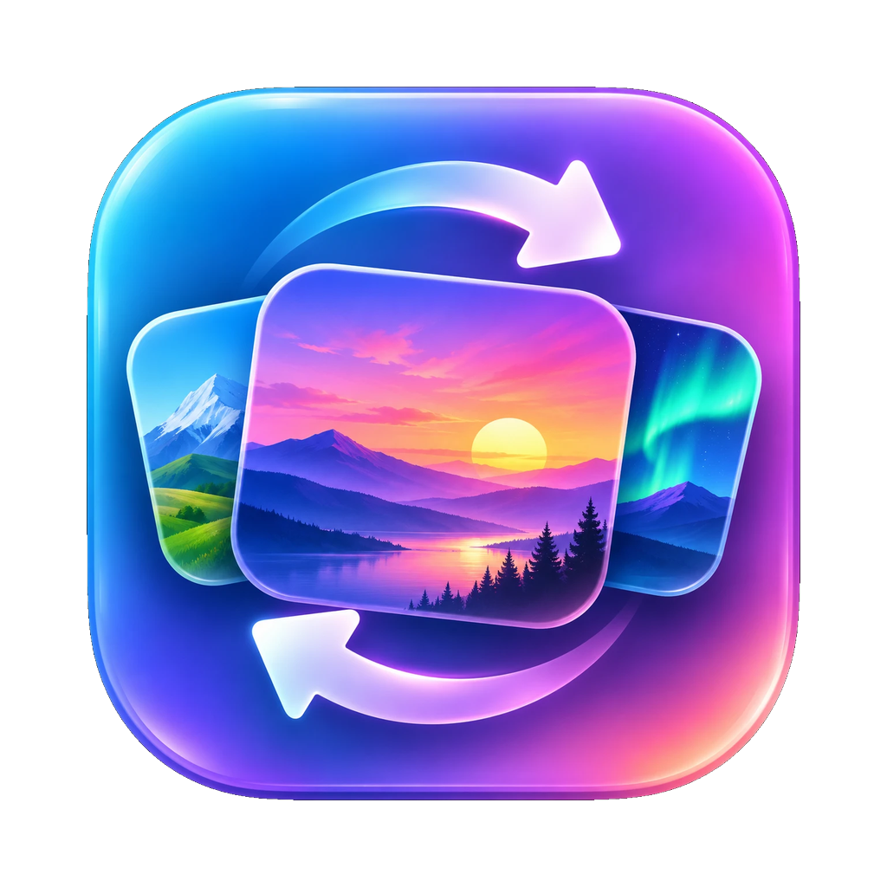

<p align="center"></p>

<h1 align="center">Wallpaper Rotator for Mac</h1>

<p align="center">
A tiny menu-bar and Dock app that changes your desktop wallpaper every few minutes with
<b>public-domain</b> pictures: nebulae and Earth from orbit, wildlife and national parks,
landscape paintings from museum collections, and optionally art from DeviantArt.
</p>

<p align="center">
<a href="https://github.com/jamalxcode/WallpaperRotatorMac/actions/workflows/ci.yml"></a>
<a href="https://github.com/jamalxcode/WallpaperRotatorMac/releases/latest"></a>
<a href="LICENSE"></a>
</p>

## Install

**[⬇ Download Wallpaper Rotator](https://github.com/jamalxcode/WallpaperRotatorMac/releases/latest/download/WallpaperRotator.zip)**
(always the newest version), unzip it, and drag **WallpaperRotator.app** to Applications. Older
versions are on the [releases page](https://github.com/jamalxcode/WallpaperRotatorMac/releases). It's a universal app (Apple silicon and Intel) and
needs macOS 13 or later.

The app isn't notarized by Apple (that needs a paid developer account), so the first time you open
it macOS blocks it. Go to **System Settings → Privacy & Security**, scroll down, and click
**Open Anyway**.

**Or build it yourself:** you need [Go](https://go.dev/dl/) 1.22+ and the Xcode Command Line Tools
(`xcode-select --install`).
```bash
git clone https://github.com/jamalxcode/WallpaperRotatorMac.git
cd WallpaperRotatorMac
make install    # builds WallpaperRotator.app, copies it to /Applications, opens it
```

## Using it
The **Settings window** opens whenever you start the app yourself (Finder, Launchpad, Spotlight),
when you click its Dock icon, or when you choose **Settings…** from the menu-bar icon. It stays
hidden when macOS starts the app at login. The app also shows in the Dock, ⌘-Tab and Force Quit.
You can also choose **Wallpaper Rotator → Settings…** (⌘,) from the menu at the top of the screen,
or right-click the Dock icon. The window always opens on the desktop you're using.

- A preview of the current picture with its title and credit
- **◀ Previous**, **Next ▶**, and **Never Show Again** (hides that picture forever and moves on)
- **Open Image Page** (source and license) and **Save to Pictures** (`~/Pictures/Wallpapers`)
- **Change every** 1, 4, 10, 30 or 60 minutes
- A **slider for each source** from Off to Very often
- **Pause**, **Start at login**, and **Keep changing on Low Power Mode and phone hotspots**
- ⌘W closes the window, ⌘Q quits, and copy and paste work in the text fields

The menu-bar icon has the same main actions.

**Updates:** choose **Check for Updates…** from the Wallpaper Rotator menu, the menu-bar icon, or
the Dock icon. It asks GitHub for the latest release and, if there's a newer one, can download it,
replace the app and restart. Your settings, history and saved pictures are kept.

> **Can't see the menu-bar icon?** On MacBooks with a notch, macOS hides icons that don't fit.
> Click the Dock icon to get the Settings window, or ⌘-drag other icons off the menu bar.

### Saves battery and data
- **Doesn't download while you're away.** Changes are skipped while the screen is locked or the
  display is asleep, and it catches up once when you come back.
- **Pauses on Low Power Mode, phone hotspots and Low Data Mode** (you can turn this off).
- **Checks NASA image sizes first.** It reads the first few KB of each image and only downloads the
  whole file if it's wallpaper-shaped.
- **Works offline.** With no internet it rotates through recent pictures and your saved favourites.
- Each source's search results are cached and used up one at a time, so every API is queried rarely.
  A source that fails is paused for 15 minutes, or for 2 hours if it reports a rate limit.

## Sources
| Source | What you get | License |
|---|---|---|
| [NASA Image Library](https://images.nasa.gov) | Nebulae, galaxies, launches, auroras, Earth from orbit | Public domain |
| **Wildlife & Nature**: [US Fish & Wildlife](https://www.fws.gov), [National Park Service](https://www.nps.gov), [NOAA](https://www.noaa.gov) via Wikimedia Commons | Wolves, puffins, whales, coral reefs, lightning, geysers | Public domain (`PD-USGov-*`) |
| [Wikimedia Commons Featured Pictures](https://commons.wikimedia.org/wiki/Commons:Featured_pictures) | Award-winning photos of nature, cities, animals | Only Public domain / CC0 files |
| [Cleveland Museum of Art](https://openaccess-api.clevelandart.org) | Landscape and seascape paintings, prints, early photos | CC0 |
| [Smithsonian American Art Museum](https://www.si.edu/openaccess) | Hudson River School, the American West | CC0 |
| [DeviantArt](https://www.deviantart.com) *(optional)* | Fantasy landscapes, space art, concept art, pixel art | © the artists, credited |

The Smithsonian uses the shared `DEMO_KEY` (about 50 requests a day). For more, add a free
[api.data.gov](https://api.data.gov/signup) key to `config.json` as `"smithsonian_api_key"`.

To change only the display with the menu bar and leave other displays alone (say, a small
status screen), add `"main_display_only": true` to `config.json` and restart the app.

### Optional: DeviantArt
DeviantArt art **belongs to its artists and is not public domain**, so this source is off until you
connect it and always credits the artist. Mature content is excluded, and by default titles naming
AI tools are skipped.

1. Sign in at https://www.deviantart.com/developers and click **Register Application**.
2. Enter a title, and as the **OAuth2 Redirect URI** any `https` URL that isn't on deviantart.com
   (it isn't used). Set **Client type** to **Confidential**. DeviantArt publishes the app as a post
   on your profile. That's normal, so don't delete it.
3. Copy the **client_id** and **client_secret** from https://www.deviantart.com/studio/apps.
4. Paste them into the **DeviantArt** section of Settings and click **Connect**.

It uses OAuth 2.0 *client credentials*, so there's no browser sign-in. You enter the keys once per
Mac: they're saved in your user folder (readable only by you) and reused on every launch and update,
with no password prompts. They're never put in this repo.

## Keeping it family-friendly
1. **Safe sources and searches.** NASA, US-government nature photos, *featured* Commons photos, and
   museum searches limited to scenery.
2. **Word filters** on titles, descriptions, keywords and categories ([`filter.go`](filter.go)). Art
   gets an extra list (Venus, nymphs, bathers…), and dull or grim photos (maps, documents, specimens,
   stranded animals) are skipped.
3. **On-device image check.** Apple's Vision framework looks at every picture before it's shown and
   skips swimwear, skulls, and pictures where people fill much of the frame. Space photos may show
   astronauts. Nothing leaves your Mac.
4. **Never Show Again** for anything that still slips through.

No filter is perfect. You can also turn every source down except NASA and Wildlife.

## Files
| What | Where |
|---|---|
| Settings | `~/Library/Application Support/WallpaperRotator/config.json` (readable only by you) |
| Recent pictures (last ~30) and history | `~/Library/Application Support/WallpaperRotator/` |
| Log (capped at 2 MB) | `~/Library/Logs/WallpaperRotator.log` |
| DeviantArt secret | `~/Library/Application Support/WallpaperRotator/deviantart-secret` (readable only by you) |

Upgrading from the old "Wallpaper Changer" moves your settings, history and DeviantArt secret over
automatically.

## Development
```bash
make test                                       # go vet + unit tests
make run                                        # build and run from the project folder
make release                                    # universal app + zip in build/
go run . --once --dry --source Wildlife         # fetch one picture without setting it
go run . --check some.jpg                       # run the on-device image check on a file
```
GitHub Actions runs the tests and a universal build on every push. Pushing a tag like `v1.2.0`
publishes a release with the zipped app.

| File | Role |
|---|---|
| `main.go` | Startup, command-line modes, single-instance handling |
| `app.go` | App state and every action (shared by menu and window), pausing, offline mode |
| `menu.go` | Menu-bar icon ([fyne.io/systray](https://github.com/fyne-io/systray)) |
| `fetch.go` | Weighted source choice, per-source cache and back-off, size probe, downloads, image-check policy |
| `config.go` | Settings, migration, history, seen and banned lists, cache and log housekeeping |
| `sources*.go` | One client per picture source |
| `filter.go` | Word filters |
| `platform_darwin.m/.h/.go` | macOS APIs: wallpaper, Spaces, lock/sleep/power/network monitor, login item (`SMAppService`), Keychain, Vision |
| `settings_darwin.m/.h/.go` | Native Settings window |
| `assets/icon.png` | App icon (`make` builds `AppIcon.icns` from it) |

## Known limitations
- macOS only lets apps set the wallpaper of the **current** Space. Other Spaces get the new picture
  when you switch to them.
- Full-screen app Spaces have no wallpaper.

## License
[MIT](LICENSE). The pictures belong to their sources: public domain or CC0, except DeviantArt art,
which belongs to its artists. Use **Open Image Page** for each picture's credit.
